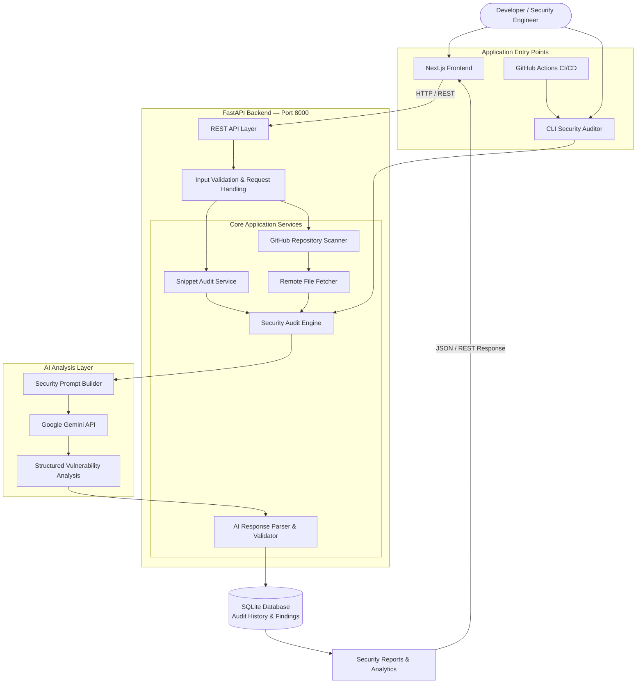
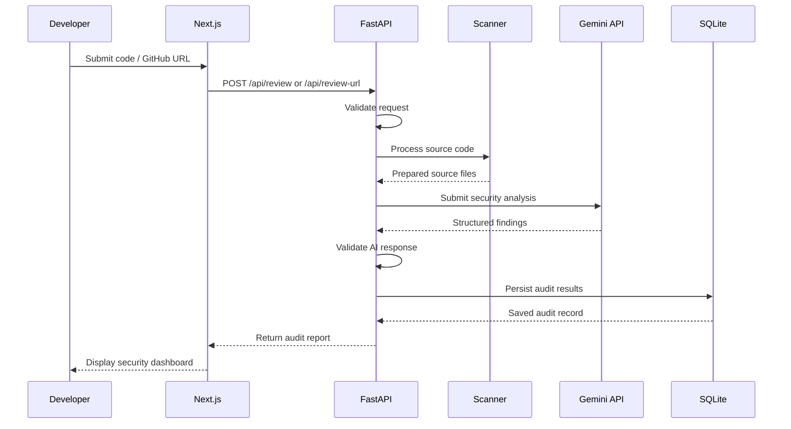
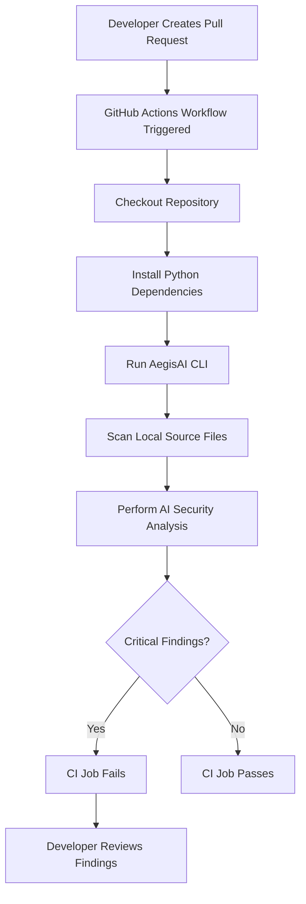

# 🛡️ AegisAI Enterprise — AI-Powered Security Auditor

**Automated Code Security Auditing, Vulnerability Detection & Compliance Analysis**

AegisAI Enterprise is an AI-powered security auditing platform designed to analyze source code snippets and public GitHub repositories for potential security vulnerabilities, software bugs, and compliance risks.

Built using **Next.js, FastAPI, SQLite, and Google Gemini AI**, AegisAI combines static code inspection with AI-driven security analysis to provide actionable vulnerability reports, code remediation suggestions, security health scores, and automated CI/CD pull request scanning.

The platform provides two primary ways to perform security audits:

- **Web Dashboard:** Submit code snippets or public GitHub repository URLs for security analysis.
- **CLI & CI/CD Integration:** Scan local source code automatically during development and GitHub Actions workflows.

---

## 🏛️ System Architecture

AegisAI follows a **modular backend architecture** with clearly separated frontend, API, scanning, AI analysis, and persistence layers.

Rather than introducing unnecessary microservices, the application uses a centralized FastAPI backend with independently organized modules. This keeps the system maintainable while allowing individual components to evolve independently.

### High-Level Architecture



### Architecture Overview

| Layer | Technology | Responsibility |
|---|---|---|
| Presentation | Next.js + Tailwind CSS | Dashboard, code editor, reports and analytics |
| API | FastAPI | Request handling, validation and API orchestration |
| Scanning | Python | Snippet analysis, repository fetching and file processing |
| AI Engine | Google Gemini API | Vulnerability analysis and remediation suggestions |
| Persistence | SQLite | Audit history, findings and report metadata |
| Automation | Python CLI + GitHub Actions | Automated repository and pull request scanning |

### Application Processing Flow

1. A developer submits a code snippet or repository URL through the dashboard.
2. Next.js sends the request to the FastAPI backend.
3. FastAPI validates the input and forwards it to the appropriate scanning service.
4. The scanning service prepares the source code for analysis.
5. The security audit engine constructs the analysis request.
6. Google Gemini analyzes the code and generates structured security findings.
7. The backend validates and processes the AI response.
8. Audit results are stored in SQLite.
9. The frontend receives the report and displays vulnerabilities, health scores, and remediation suggestions.

The CLI follows the same core auditing logic but can operate directly on local source files without requiring the web dashboard.

---

## 🔍 System Components & Responsibilities

### 1. Frontend Layer — Next.js + Tailwind CSS

The frontend provides an interactive security auditing dashboard for developers and security engineers.

**Key Features:**

**Security Audit Dashboard**
- Overview of completed security audits.
- Security health scores (0–100).
- Vulnerability distribution by severity.
- Audit history and recent scanning activity.

**Code Editor & Snippet Auditor**
- Submit source code snippets for analysis.
- Language selection and automatic line counting.
- Direct AI-powered security analysis.
- Display findings with relevant source-code line references.

**GitHub Repository Scanner**
- Submit public GitHub repository URLs.
- Fetch supported source files for analysis.
- Display repository-level security findings.
- Present findings grouped by severity and file.

**Vulnerability & Remediation Viewer**
- Critical, High, Medium and Low severity classifications.
- Vulnerability descriptions and affected code locations.
- Suggested secure code replacements.
- Proposed code diff blocks.
- Copy-to-clipboard functionality.

**Audit History & Reports**
- View previous security audits.
- Access detailed vulnerability information.
- Export reports in Markdown and JSON formats.

### 2. Backend API Engine — FastAPI

FastAPI acts as the central application layer responsible for request processing, scanning orchestration, AI integration, and database operations.

**Core API Endpoints**

| Method | Endpoint | Responsibility |
|---|---|---|
| POST | `/api/review` | Analyze submitted source code snippets |
| POST | `/api/review-url` | Scan supported files from public GitHub repositories |
| GET | `/api/audits` | Retrieve audit history |
| GET | `/api/audits/{id}` | Retrieve a specific audit report |
| GET | `/api/export/{id}` | Export an audit report |

**Backend Responsibilities:**

- Validate incoming API requests.
- Handle snippet and repository scanning workflows.
- Fetch supported source files from public GitHub repositories.
- Construct structured prompts for AI analysis.
- Process and validate AI-generated responses.
- Store audit history and vulnerability metadata.
- Provide report retrieval and export functionality.

**Repository Scanner**

The GitHub scanner is responsible for:
- Parsing supported public GitHub repository URLs.
- Identifying supported source files.
- Fetching source files without requiring a local repository clone.
- Filtering unsupported files and oversized inputs.
- Passing eligible source code to the security audit engine.

### 3. AI Security Core — Google Gemini API

The AI analysis layer performs security-focused code reviews using Google Gemini.

It evaluates source code against established security guidance, including:

- OWASP Top 10.
- Common Weakness Enumeration (CWE).
- Secure coding practices.
- Common authentication and authorization weaknesses.
- Input validation and injection risks.
- Sensitive information exposure.

**AI Analysis Output**

The backend expects structured analysis containing:

| Output | Description |
|---|---|
| Health Score | Overall security assessment score (0–100) |
| Severity | Critical, High, Medium or Low |
| Vulnerability | Description of the identified issue |
| Location | Affected file and line references, where available |
| Explanation | Why the code may be vulnerable |
| Remediation | Suggested secure implementation |
| Code Diff | Proposed code changes, where supported |

AI-generated findings should be treated as recommendations, not guaranteed vulnerability detections. Results must be validated before being treated as confirmed security issues.

### 4. Persistence Layer — SQLite

SQLite provides lightweight relational persistence for audit records and historical analysis.

**Stored Information:**
- Audit identifiers and timestamps.
- Source type and file metadata.
- Security health scores.
- Vulnerability descriptions.
- Severity classifications.
- Suggested code remediations.
- Structured audit reports.

The database allows users to retrieve historical reports and monitor security audit activity.

### 5. CLI & CI/CD Automation

AegisAI includes a Python command-line utility (`audit_cli.py`) for integrating security audits into automated development workflows.

**CLI Capabilities:**
- Scan local source-code directories.
- Run security analysis during CI/CD execution.
- Generate security audit findings.
- Enforce configurable severity thresholds.
- Return non-zero exit codes when configured security conditions are met.

**Example CLI Execution:**

```bash
python audit_cli.py --path ./src --fail-on critical
```

This command scans the specified source directory and fails the CI job when a Critical finding is detected, assuming the CLI implements this threshold correctly.

---

## 🔄 End-to-End Data Flow

### Web Dashboard Audit



### CI/CD Pull Request Audit



---

## 🔐 Security & Reliability Considerations

Because AegisAI processes potentially untrusted source code and communicates with an external AI provider, the following safeguards are important:

**Input Validation**
- Validate code snippets, repository URLs and request sizes.
- Restrict supported file extensions.
- Apply request timeouts and resource limits.

**Repository Scanning**
- Support public repositories only unless authenticated access is explicitly implemented.
- Restrict remote fetching to trusted GitHub hosts.
- Prevent server-side request forgery (SSRF).
- Avoid executing downloaded repository code.

**AI Security**
- Treat repository content as untrusted input.
- Defend against prompt injection embedded in source files.
- Validate AI responses against a defined schema.
- Never execute AI-generated remediation automatically.

**Secrets Management**
- Store Gemini API keys in environment variables.
- Use GitHub Actions Secrets for CI/CD credentials.
- Never expose API keys in frontend code or commit them to Git.

**Database & API**
- Validate database operations.
- Implement authentication and authorization where required.
- Apply appropriate rate limits.
- Handle failures from external AI services gracefully.

---

## ⚡ Complete Quickstart Guide

### Prerequisites

Install the following before starting:

- Python 3.10+
- Node.js 18+
- npm
- Git
- Google Gemini API Key

Obtain an API key from [Google AI Studio](https://aistudio.google.com/).

### Step 1: Clone the Repository

```bash
git clone <YOUR_GITHUB_REPOSITORY_URL>
cd AegisAI
```

### Step 2: Backend Setup — FastAPI

Navigate to the backend directory:

```bash
cd backend
```

Create a virtual environment:

```bash
python -m venv venv
```

Activate the environment.

**Windows PowerShell:**

```powershell
.\venv\Scripts\Activate.ps1
```

**macOS / Linux:**

```bash
source venv/bin/activate
```

Install dependencies:

```bash
pip install -r requirements.txt
```

Create a `.env` file inside the backend directory:

```env
GEMINI_API_KEY=your_actual_api_key_here
```

Start the FastAPI development server:

```bash
python -m uvicorn app.main:app --reload --port 8000
```

Backend API:

`http://localhost:8000`

Interactive API documentation:

`http://localhost:8000/docs`

### Step 3: Frontend Setup — Next.js

Open another terminal and navigate to the frontend directory:

```bash
cd frontend
```

Install dependencies:

```bash
npm install
```

Create a `.env.local` file:

```env
NEXT_PUBLIC_API_URL=http://localhost:8000
```

Start the development server:

```bash
npm run dev
```

Open the application:

**http://localhost:3000**

You can now access the AegisAI Enterprise security auditing dashboard.

---

## 🤖 GitHub Actions CI/CD Integration

AegisAI supports automated security scanning during GitHub pull request workflows using its Python CLI.

Create the following workflow file in your repository:

`.github/workflows/audit.yml`

```yaml
name: AegisAI Automated Security Audit

on:
  pull_request:
    branches:
      - main

permissions:
  contents: read

jobs:
  security-audit:
    name: Security Vulnerability Scan
    runs-on: ubuntu-latest

    steps:
      - name: Checkout Repository
        uses: actions/checkout@v4

      - name: Set up Python
        uses: actions/setup-python@v5
        with:
          python-version: "3.10"

      - name: Install Dependencies
        run: |
          python -m pip install --upgrade pip
          pip install -r backend/requirements.txt

      - name: Run AegisAI Security Audit
        env:
          GEMINI_API_KEY: ${{ secrets.GEMINI_API_KEY }}
        run: |
          python audit_cli.py --path ./src --fail-on critical
```

**Important:** Adjust the dependency file and CLI path according to the actual repository structure. The CLI must support the specified arguments and read the Gemini key from the environment. Configure the GitHub repository secret `GEMINI_API_KEY` before enabling the workflow.

The workflow automatically runs when a pull request targets the `main` branch.

If a configured Critical vulnerability is detected, the CLI returns a non-zero exit code and the security audit job fails.

---

## 📁 Suggested Project Structure

```text
AegisAI/
│
├── frontend/
│   ├── app/
│   ├── components/
│   ├── hooks/
│   ├── lib/
│   ├── public/
│   └── package.json
│
├── backend/
│   ├── app/
│   │   ├── main.py
│   │   ├── api/
│   │   ├── services/
│   │   ├── scanners/
│   │   ├── ai/
│   │   ├── database/
│   │   └── schemas/
│   │
│   ├── requirements.txt
│   └── .env
│
├── .github/
│   └── workflows/
│       └── audit.yml
│
├── audit_cli.py
├── .gitignore
├── LICENSE
└── README.md
```

*This is a suggested logical organization. Adapt it to the actual files and modules in the implementation.*

---

## 🚀 Future Enhancements

Potential improvements for future versions include:

- Support for additional programming languages.
- Integration with traditional static analysis tools such as ESLint.
- GitHub App integration for automated pull request comments.
- Incremental scanning of changed files instead of entire repositories.
- Configurable security policies and severity thresholds.
- Role-based access control.
- PostgreSQL support for larger deployments.
- Background task processing for large repository audits.
- Docker-based deployment.
- Security trend analytics and compliance reporting.
- Automated regression checks for previously identified vulnerabilities.

---

**AegisAI Enterprise — Intelligent Security. Safer Code. Smarter Development.**